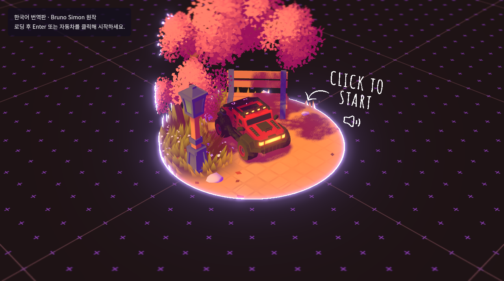
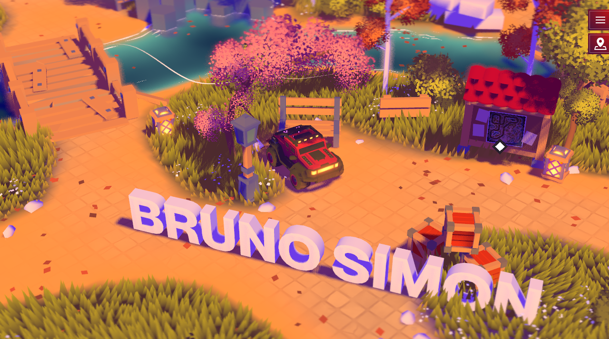
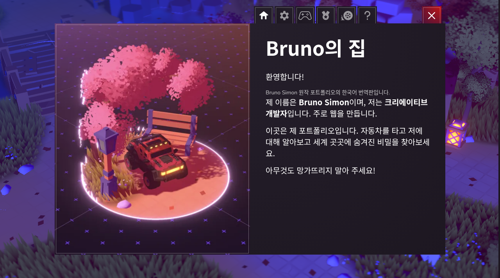

# 🚗 Bruno Simon Folio 2025 한글판

자동차를 몰고 작품, 연구실, 경력, 볼링장과 경주 트랙을 둘러보는 **탐험형 3D 포트폴리오**입니다. Bruno Simon의 `folio-2025`를 한국어로 번역하고 GitHub Pages에서 실행할 수 있도록 서버 없는 정적판으로 구성했습니다.

**[🎮 브라우저에서 실행하기](https://sigco3111.github.io/folio-2025/)** · [원작 저장소](https://github.com/brunosimon/folio-2025) · [English README](README.en.md) · [라이선스 원문](license.md)

> Bruno Simon의 작품을 번역한 포크입니다. 이름·경력·작품·연락처는 원작자 정보이며, 포크 소유자의 포트폴리오로 바꾸지 않았습니다.

## 📸 실제 실행 화면



*Pages 한국어판의 시작 장면입니다. 3D 자산에 그려진 CLICK TO START 등 일부 글자는 원본 영문입니다.*



*로딩 후 세계로 진입한 실제 화면입니다. 그림자·지형·자동차와 탐험 구역을 확인할 수 있습니다.*



*원작자의 이름·소개와 한국어 번역판 표기를 함께 유지한 홈 메뉴입니다.*

## ✨ 주요 기능

| 기능 | 즐기는 방법 |
|---|---|
| 자동차 탐험 | 13개 구역을 이동하며 작품과 원작자의 경력을 살펴보기 |
| 상호작용 | 가까운 지점에서 안내에 따라 Enter로 콘텐츠 열기 |
| 놀이 공간 | 볼링장과 경주 트랙 등 물리 기반 체험 |
| 업적 | 정적판에서 가능한 로컬 업적과 탐험 목표 |
| 지도·메뉴 | 한국어 구역 이름, 홈, 설정, 조작 방법, 제작 이야기 |
| 환경 효과 | 시간·계절·날씨, 식생, 조명과 후처리 효과 |
| 입력 | 키보드·터치·게임패드 지원 |

## 🎮 시작과 조작

1. 실행 링크를 열고 자동차가 나타날 때까지 기다립니다. 첫 로딩과 시작 애니메이션은 기기 성능에 따라 오래 걸릴 수 있습니다.
2. **Enter**를 누르거나 자동차를 클릭해 세계로 진입합니다.
3. 자동차로 탐험하고 가까운 상호작용 지점에서 화면 안내를 따릅니다. 메뉴의 **조작 방법**에서 입력 장치별 도움말을 확인하세요.

| 키 | 기능 |
|---|---|
| WASD / 방향키 | 자동차 이동 |
| Shift | 부스트 |
| B / 왼쪽 Ctrl | 제동 |
| Space | 점프 |
| Enter | 상호작용 |
| M | 지도 |
| R | 가까운 출발점으로 복귀 |
| L | 음소거 |
| H | 경적 |
| 숫자키 | 유압 서스펜션 |
| 마우스 드래그 | 카메라 이동 |

모바일은 터치 조작, 게임패드는 스틱과 버튼을 사용합니다. 지원 여부와 성능은 브라우저·장치에 따라 다릅니다.

## 🛠️ 기술 스택

아래 버전은 `package.json`의 선언 기준이며 실제 설치 버전은 `package-lock.json`을 따릅니다.

| 계층 | 기술과 역할 |
|---|---|
| 언어·번들러 | JavaScript ES Modules, Vite 7.2 계열, Stylus |
| 3D 엔진 | Three.js 0.183 계열, `three/webgpu`, WebGPURenderer |
| 셰이더·후처리 | Three.js TSL 노드, RenderPipeline, bloom, 경량 피사계 심도(cheapDOF) |
| 물리 | Rapier 3D 0.17 계열, WebAssembly, 강체·충돌·차량 시뮬레이션 |
| 사운드 | Howler.js 2.2 계열 |
| 애니메이션·카메라 | GSAP 3.12 계열, camera-controls |
| 개발 패널 | Tweakpane 4, stats-gl |
| 자산 처리 | glTF Transform, Sharp, 압축 모델·텍스처, Blender 원본 |
| 배포 | GitHub Actions + GitHub Pages, 서버 없는 정적 호스팅 |

### 렌더링과 물리 구조

`Game`이 공통 상태와 하위 시스템을 연결합니다. `Rendering`은 WebGPURenderer를 초기화하고 그림자와 후처리 파이프라인을 구성합니다. WebGPU를 우선 사용하며 지원되지 않는 환경에서는 Three.js의 WebGL 대체 경로를 사용합니다. 고품질 설정은 bloom과 cheapDOF를 조합하고, 낮은 품질 설정은 일부 후처리를 줄입니다.

`Physics`는 Rapier 세계와 충돌 이벤트 큐를 구성합니다. 게임의 ticker가 입력 → 차량 물리 전처리 → 물리 계산 → 차량·플레이어 후처리 → 카메라 → 환경·구역 → 렌더링 순으로 시스템을 갱신합니다. 순서가 중요한 이유는 물리 결과를 차량 모델과 카메라에 반영한 뒤 화면을 그려야 하기 때문입니다. 원문 README에는 세부 게임 루프 단계가 보존되어 있습니다.

### 주요 소스 위치

```text
sources/index.html       HTML 진입점, 한국어 안내
sources/index.js         앱 진입점
sources/Game/Game.js     공통 게임 상태와 시스템 구성
sources/Game/Rendering.js 렌더러와 후처리
sources/Game/Physics/    Rapier 물리와 차량
sources/Game/World/      식생·눈·비·지형 등 세계 요소
sources/Game/World/Areas/      탐험 구역
sources/Game/Achievements.js 로컬 업적
sources/Game/Server.js   정적판에서 연결 차단
sources/Game/Audio.js    사운드
static/                 모델·텍스처·음악 등 정적 자산
resources/              Blender·PSD 등 제작 원본
scripts/compress.js     자산 압축 도구
vite.config.js          빌드·정적 자산·base 경로 설정
localize.mjs            번역과 정적판 파일 적용
```

## 🔌 원작 서버와 분리한 정적판

| 항목 | 이 포크의 상태 |
|---|---|
| 원작 서버 접속 | 코드와 환경 설정 양쪽에서 차단 |
| Whispers 방문자 메시지 | 비활성화 |
| 공유 순위표·기록 제출 | 제공하지 않음 |
| 서버 전용 업적 | 제외 |
| 경주 체험·로컬 업적 | 사용 가능 |
| Google Analytics | 원작 수집 코드 제거 |
| 원작자·커뮤니티 링크 | 사용자가 직접 클릭할 때 이동 |

로컬 업적은 브라우저의 `localStorage`에 저장됩니다. 브라우저 데이터를 지우거나 다른 기기·브라우저로 접속하면 같은 기록이 이어지지 않습니다. 서버에 동기화되는 계정 저장은 제공하지 않습니다. 서버 차단이 모든 외부 통신을 없앤다는 뜻은 아닙니다. GitHub Pages와 글꼴 등의 자산 요청은 여전히 필요합니다.

## 💻 로컬 실행과 빌드

GitHub Actions에서 사용하는 **Node.js 22**를 권장합니다.

```bash
git clone https://github.com/sigco3111/folio-2025.git
cd folio-2025
npm ci --legacy-peer-deps
node localize.mjs

# 개발: 터미널에 표시된 Vite 주소로 접속
npm run dev

# 프로덕션 빌드와 확인
npm run build
npm run preview
```

환경 파일이 필요한 경우 `.env.example`을 `.env`로 복사하되 `VITE_SERVER_URL`과 `VITE_ANALYTICS_TAG`는 비워 두세요. 이 포크의 서버 차단을 해제하거나 원작 서버 주소를 넣지 마세요. 압축 자산 등 정적판 기본값은 소스의 설정을 따릅니다.

큰 자산 때문에 빌드 메모리가 부족하면 macOS/Linux에서 `NODE_OPTIONS=--max-old-space-size=6144 npm run build`를 사용할 수 있습니다. Actions도 같은 메모리 옵션을 사용합니다. `--legacy-peer-deps`는 원작 의존성 조합의 설치 호환성을 위한 옵션이며 모든 의존성을 최신화한다는 뜻은 아닙니다.

### Vite·Pages 설정

- Vite 루트는 `sources/`, 정적 자산은 `static/`, 빌드 출력은 `dist/`입니다.
- `base: './'`로 저장소 하위 경로에 배포할 수 있도록 구성합니다.
- WASM·top-level await 플러그인으로 물리 엔진 초기화를 처리합니다.
- `.github/workflows/pages.yml`은 `main`에서 번역 적용 → 의존성 설치 → Vite 빌드 → `dist/` 업로드 → Pages 배포를 수행합니다.
- README만 변경하면 워크플로의 제외 규칙에 따라 게임 재빌드를 생략합니다.
- `npm run compress`는 자산 처리용입니다. 일반 실행·문서 갱신에는 필요하지 않습니다.

## 🇰🇷 한글화 범위

홈 소개, 설정, 키보드·터치·게임패드 도움말, 업적 이름·목표, 지도 구역, 제작 이야기, 경주 안내, 상호작용 버튼을 번역했습니다. Noto Sans KR을 적용하고 원본 ID·고유명·개발자 이름·URL을 유지했습니다.

**남아 있는 영문:** 3D 모델·KTX 이미지에 구워진 경력 설명과 간판, 시작 화면의 일부 그래픽입니다. 코드 문자열과 다른 자산이므로 이번 UI 번역에 포함되지 않습니다. 원문 문서는 `README.en.md`에 보존했습니다.

## ⚠️ 제한과 문제 해결

- 최신 브라우저와 GPU·하드웨어 가속을 권장합니다. WebGL 대체 경로에서도 성능과 효과가 같다고 보장하지 않습니다.
- 고해상도 3D 자산이 많아 초기 로딩과 빌드가 무겁습니다. 자동차가 나타난 뒤 시작하고, 낮은 성능에서는 품질 설정을 낮춰 보세요.
- 검은 화면·멈춤이 나타나면 브라우저 GPU 지원과 자산 요청 실패를 확인하세요. 로컬 HTML 직접 실행 대신 Vite를 사용해야 합니다.
- 메뉴의 로컬 업적은 사용할 수 있지만 서버·Whispers·온라인 순위표는 정적판의 범위 밖입니다.
- 원작의 `localhost:1234` 안내보다 현재 Vite가 출력하는 주소를 기준으로 접속하세요.
- `localize.mjs`는 대상 소스를 다시 적용합니다. 코드를 직접 수정할 때 스크립트의 내장 파일도 확인하세요. 한국어 README는 별도 문서로 보호합니다.

## 📚 라이선스와 크레딧

원작자는 **Bruno Simon**입니다. 작품·프로필·연락처·외부 링크는 원작자 정보를 그대로 유지합니다.

- `license.md`에는 **MIT**, 원본 `package.json`에는 **ISC**가 적혀 있어 표기가 불일치합니다. 이 README는 라이선스 파일의 MIT를 표시하되 불일치를 숨기지 않습니다. 원문 라이선스는 변경하지 않았습니다.
- 원작 음악: **Kounine, CC0**. 원작 크레딧과 Three.js, Rapier, Howler.js 등 외부 라이브러리 고지를 유지합니다.
- 재사용 시 코드뿐 아니라 포함된 모델·텍스처·음악과 외부 라이브러리의 개별 고지도 확인하세요.
- 스크린샷은 GitHub Pages 한국어판에서 직접 캡처한 화면입니다.
